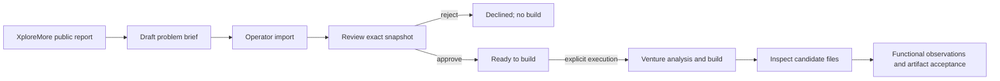

# XploreMore -> reviewed specification -> Pro2Pro

The public workspace at `/workspace` validates imported briefs locally. It displays
source evidence alongside the exact scope and Given/When/Then acceptance criteria.
The bundled example is a historical XploreMore source record plus a sample product
specification. It is not a fresh discovery, human demand validation or a generated product.

## The actual handoff



`contracts/problem-brief.v1.schema.json` is generated from `p2pops.briefs.ProblemBrief`.
Both browser validators use the same schema. The contract permits one bounded
browser-only tool, 1-10 HTTP(S) source excerpts, 1-6 scope items and 1-6 acceptance
criteria. Import is bounded to 64 KB. Unknown fields, missing evidence, empty scope
and malformed types are rejected. Source text remains untrusted data.

The contract contains a snapshot timestamp and observed reporter/source counts.
Counts inherit the provider's identity, classification and clustering limitations;
they do not establish independent customers or willingness to pay. An imported file
is an operator-supplied snapshot, not a provider-authenticated attestation.

## Approval is a recorded boundary

- Operator routes deny missing credentials by default. The only bypass is explicit
  `ALLOW_LOCAL_OPERATOR_BYPASS=true` with `ENVIRONMENT=development`.
- GET email links show a read-only preview; POST requires a confirmation nonce and
  SameSite cookie. They remain bearer capabilities: anyone holding a valid link can
  deliberately decide it. These mechanisms are not an identity-verification system.
- A review stores canonical JSON and SHA-256 of title, description, reasoning,
  original provenance and the problem brief. Approval must reference that digest.
- Token consumption and run-resume claims use conditional database updates. A
  repeated/simultaneous decision cannot consume the same review twice.
- An edited idea invalidates approval. Original approved evidence is carried in
  venture/build prompts and persisted dossiers; supplementary search does not replace it.
- Imported brief approval reaches `ready_to_build` without a model, email or publish.
  Execution requires an explicit protected request and a configured model. Configuration
  is not availability. With no model configured, the approved brief remains usable.

## Generated artifacts need separate acceptance

For bound-snapshot builds, automatic publication is withheld. Model-produced QA is
structured document review, not execution. The protected artifact endpoint exposes
the source files and a SHA-256 over ordered paths/content. Acceptance requires an
observation for every approved criterion, an explicit method, and the current artifact
hash. Passing checks must all be true to accept. A second decision cannot overwrite
the first. No publication is triggered by acceptance.

The server records authenticated operator assertions; it does **not** independently
verify browser execution. The interface displays source and exports context without
executing arbitrary generated code. Run functional checks in an isolated environment
and keep their artifacts. No newly generated product-quality result is claimed here.

## Local rehearsal without paid calls

Use two terminal windows and a disposable directory; no secrets need to be committed:

```powershell
# Pro2Pro backend (from repository root)
uv sync --all-groups --frozen
$env:DATA_DIR='..\pro2-review-data'
$env:API_TOKEN='replace-with-a-local-operator-key'
uv run uvicorn p2pops.api.app:app --host 127.0.0.1 --port 8015

# Pro2Pro web (from web/)
pnpm install --frozen-lockfile
pnpm test
$env:PROTOPRO_API_URL='http://127.0.0.1:8015'
pnpm build
pnpm start --hostname 127.0.0.1 --port 3121
```

Open `/workspace`, inspect the recorded example or import the JSON exported by
XploreMore, enter the local operator key, import, inspect and approve/reject.
No provider key is needed for this journey. An explicit model build remains unavailable
without one; do not silently substitute a recorded response. Never use real private
prompts or credentials in portfolio demonstration briefs.

Tests cover strict guardrail decision parsing, missing operator configuration,
read-only link scanning, nonce checks, changed snapshots, simultaneous decisions,
idempotent imports, missing models, original evidence through real graph orchestration,
artifact-hash binding and incomplete acceptance evidence. Model outputs are deterministic
fakes in orchestration tests, not measurements of model quality.

## Boundaries and failure recovery

Discovery checkpoints survive a human pause. Imported approved briefs now also
use a persisted execution job and checkpointed venture/build graphs. Claiming the
run, creating its job and assigning its opportunity identity commit atomically.
A lifespan worker drains pending jobs; a kernel lock permits one imported-brief
worker per persistent host. Build identity is assigned once before generation.

A process restart resumes the same job with the same graph thread IDs. The worker
revalidates the approved snapshot and source/runtime fingerprint before recovery.
Missing configuration leaves the job queued without consuming an attempt; genuine
graph errors become visible terminal failures requiring operator investigation.
Code/runtime changes require review rather than silently replaying old checkpoints.

This guarantee requires persistent SQLite/checkpoint files on a single host.
Ephemeral cloud disks do not establish durability. Interrupted nodes without a
committed checkpoint can repeat, including model requests; no exactly-once billing
claim is made. Legacy discovery-triggered venture/build paths retain their prior
orphan handling. See `durable-execution-protocol.md` for the frozen failure campaign.

SQLite additive migrations cover existing deployed databases, including nullable
snapshot and acceptance fields. Legacy reviews without a bound snapshot cannot
approve a changed/unbound idea; create a new review. Postgres migration is not
established by changing a connection string alone.

## Evidence

The prior discovery comparison (16 trials, 8 paired topics) completed research in
5/8 XploreMore trials and 7/8 HN/web trials. Provider-rate waits/timeouts complicate
interpretation; LLM shortlisting is not human problem-quality ground truth. No new
comparison was run and no source-quality or user-impact gain is claimed.

See XploreMore `docs/reports/pro2pro-discovery-ab.md`, shared contract fixtures,
`tests/test_brief_handoff.py`, and web `test/brief-contract.test.mjs`.

## Public recorded edition and local rehearsal

`/discover` hosts a clearly labeled recorded edition of XploreMore's evidence
workbench. It uses the same public source fixture and contract as the separate
repository. It is not a live news/discovery deployment. `/workspace` can record
a local review in browser session storage, preserving a decision for the same
brief checksum across reloads. Exported local review records cannot authorize
a backend build; operator approval remains a separate authenticated decision.

Production hosting must be verified separately. At redevelopment inspection, the
existing Render API returned HTTP 503 while the Vercel website returned 200. The
Render Blueprint specifies a paid Starter service; it was not applied or reactivated
as part of local validation. Local queue, approval and artifact checks do not prove
that remote service is available.


## Same-tab draft handoff

The recorded `/discover` workbench validates the edited specification before
placing a draft in browser session storage. Its opaque handoff ID opens
`/workspace`, where the visitor explicitly loads the draft. The URL contains no
source excerpts, credentials or approval. Missing tab storage has a recoverable
error and JSON import remains available. Browser rehearsal is separate from the
authenticated, snapshot-bound backend decision.

See `engineering-idea-fit.md` for the disposition of all 15 supplied ideas.
